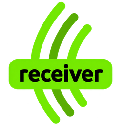

# SmartRace Receiver for Home Assistant

[Home Assistant](https://www.home-assistant.io/) is an open-source platform that brings devices, dashboards and automations together, with an emphasis on local control and privacy.

[SmartRace](https://www.smartrace.de/en/) is a slot-car racing app for lap counting, timing, driver and car management, practice, qualifying and races.

This is an independent community integration maintained by Gert Bezuidenhout, not an official SmartRace or Home Assistant product.

Receive SmartRace events in Home Assistant and create race-data sensors automatically. No receiver automation, template-sensor YAML or helpers are needed.

## What it does

- Receives JSON events through a generated webhook URL.
- Supplies race status, weather, target laps and last-received time.
- Creates driver, car-name, completed-lap and fuel sensors for controllers 1–8.
- Exposes latest lap/sector details, VSC, penalties, damage, pit information and results when supplied.
- Retains the race model across restarts and provides data-quality diagnostic indicators.
- Includes optional, disabled-by-default test buttons.

**Receiver receives data.** [SmartRace Connect](https://github.com/gert-bezuidenhout/ha.smartrace-connect) sends commands to the app. Dashboards and track-effect automations are separate.

## Install with HACS

These integrations have not yet been accepted into the default HACS Marketplace catalogue. For now, install through HACS as a custom repository:

1. Install and configure [HACS](https://www.hacs.xyz/docs/use/) in Home Assistant if needed.
2. Open HACS, open its menu and select **Custom repositories**.
3. Add `https://github.com/gert-bezuidenhout/ha.smartrace-receiver` with type **Integration**.
4. Find **SmartRace Receiver**, download it and restart Home Assistant.
5. Open **Settings > Devices & services > Add integration** and select **SmartRace Receiver**.

Once the repository is accepted into the default catalogue, the custom-repository step will no longer be needed. HACS downloads the integration; adding it under Devices & services completes setup. No configuration.yaml changes are required.

## Configure SmartRace

1. Copy the complete webhook URL from the Receiver setup dialog into SmartRace's event/webhook destination setting.
2. Keep **Accept requests from the local network only** enabled when SmartRace is on your home network.
3. Finish setup and run a short race.
4. Open the Receiver device in Home Assistant and check **Last received** and the active controller sensors.

You can view the URL again through **Configure**. If Home Assistant cannot determine its address, configure its internal URL under **Settings > System > Network**, then reopen the dialog. Treat the generated webhook URL as a secret.

## Understanding the sensors

| Sensor group | Meaning |
| --- | --- |
| Controller 1–8 | Main state is the driver's name; attributes contain driver/car and timing details. |
| Controller lap, fuel, car name | Convenient individual values for cards and automations. |
| Race live | State is an update marker; the `data` attribute holds the race model. |
| Status / target laps | Current race status and SmartRace's configured lap target. |
| Weather / weather state | Weather retains the model value; weather state additionally resets to dry at race end. |
| Latest lap and event details | Latest accepted data in each category, not a historical event log. |
| Data stale / lap gaps / missing results | Diagnostic indicators of potentially incomplete data. |

Entity IDs normally begin with `sensor.smartrace_receiver_`. Inactive controllers or values not yet received can show **Unknown**. Driver names populate from incoming data; no manual driver list is required.

Identity may arrive before the first completed lap. Sector-crossing events can update indicators immediately, but sector durations require a payload containing those durations. The integration does not invent missing times.

## Optional test buttons

Enable the desired Test entities under **Settings > Devices & services > Entities**. Available tests cover prepare_for_start, starting, running, ended, four weather states and VSC deployed/retracted.

Tests update Home Assistant only; they do not control SmartRace. They can trigger your automations. Preparing clears current readings, and ending without real results can activate Missing results. The `smartrace_receiver.manual_update` action provides the same local testing mechanism.

## Troubleshooting and privacy

- **No data:** check SmartRace's destination URL, local network access and Last received.
- **Only some values appear:** run a short race; values depend on which events SmartRace sends.
- **Old templates still change:** Receiver publishes `smartrace_data_received` for compatibility. This does not mean it depends on those templates.
- **Migrating an old setup:** follow [MIGRATION.md](MIGRATION.md) before removing old sensors or automations.

Events missed while Home Assistant is offline cannot be recovered. Saved state includes driver/car metadata. Diagnostic downloads omit raw payloads and the webhook secret; also redact personal information from any logs or screenshots you share.

## Updates and removal

Download updates through HACS and restart Home Assistant. Keep the existing integration entry when updating. Older installations should read [MIGRATION.md](MIGRATION.md).

To uninstall, remove the integration entry under Devices & services, remove its download in HACS and restart Home Assistant. Check any automations that used its entities.

## Support and project files

Report problems through [GitHub Issues](https://github.com/gert-bezuidenhout/ha.smartrace-receiver/issues), including Home Assistant/integration versions, steps to reproduce and redacted logs.

See [repository file guide](docs/FILES.md) for what is included, and [Marketplace preparation](docs/HACS_SUBMISSION.md) for the maintainer checklist.

## Licence

Project code is licensed under the [MIT licence](LICENSE), copyright Gert Bezuidenhout. Product names and third-party branding remain the property of their respective owners; this project does not imply their endorsement.
